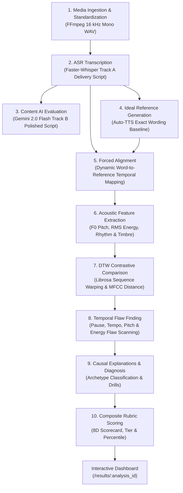

# Vox — Counterpointing Speech Analytics & Temporal Flaw Finding

[](https://fastapi.tiangolo.com)
[](https://vitejs.dev)
[](https://react.dev)
[](https://www.typescriptlang.org)
[](https://www.python.org)
[](https://librosa.org)
[](https://docs.pytest.org)

**Vox** is an autonomous, production-ready speech analytics platform that measures both **HOW you say it** (acoustic delivery prosody, cadence, and dynamic energy) and **WHAT you say** (linguistic clarity, grammar, and semantic coherence). 

It features automated ideal reference generation, forced alignment, Librosa Dynamic Time Warping (DTW), mathematical temporal flaw detection, causal phonetic diagnosis, and multi-tiered rubric scoring — presented through an interactive Plotly dashboard.

---

## Table of Contents

1. [Core Architectural Foundation](#1-core-architectural-foundation)
2. [Key Capabilities](#2-key-capabilities)
3. [The 10-Stage Processing Pipeline](#3-the-10-stage-processing-pipeline)
4. [Interactive Visualization Suite](#4-interactive-visualization-suite)
5. [Contrastive Demo Dataset](#5-contrastive-demo-dataset)
6. [System Architecture & Flowchart](#6-system-architecture--flowchart)
7. [Installation & Setup](#7-installation--setup)
8. [Running the Application](#8-running-the-application)
9. [Running Tests & Quality Assurance](#9-running-tests--quality-assurance)
10. [Comprehensive API Reference](#10-comprehensive-api-reference)
11. [Project Directory Layout](#11-project-directory-layout)
12. [Troubleshooting & FAQ](#12-troubleshooting--faq)

---

## 1. Core Architectural Foundation

### The Fundamental Speech Problem
Traditional speech training relies on subjective human feedback or crude text-matching that ignores acoustic phonetics. But impactful public speaking is a counterpoint between vocal acoustics and content structure:
- **HOW you speak:** Pitch variation, rhythm, pause placement, vocal energy, syllable tempo, and spectral clarity.
- **WHAT you say:** Semantic coherence, syntactic precision, vocabulary sophistication, and rhetorical flow.

### The Strict Two-Track Invariant Rule
Vox enforces a strict two-track separation across every stage of processing:

```
                          [Participant Speech]
                                    │
                    ┌───────────────┴───────────────┐
                    ▼                               ▼
          TRACK A: HOW IT WAS SAID        TRACK B: WHAT WAS SAID
        (Exact Words Acoustic Baseline)  (Polished Linguistic Content)
                    │                               │
        • Faster-Whisper Word Alignment   • Gemini Linguistic Evaluation
        • Zero Wording Alteration         • Polished Corrected Transcript
        • Auto-TTS Delivery Reference     • Grammar & Syntax Scoring
        • Dynamic Time Warping (DTW)      • Semantic Clarity & Rhetoric
        • Temporal Flaw Detection         • Educational Script Learning
                    │                               │
                    └───────────────┬───────────────┘
                                    ▼
                      [Multi-Tiered Rubric Scoring]
```

1. **Track A (Delivery Reference — Acoustic "HOW"):**
   - Transcribes the participant's exact words using Faster-Whisper with word-level timestamps.
   - Normalizes strictly for punctuation, capitalization, and sentence boundaries. **Never rewrites, substitutes, or removes participant vocabulary.**
   - Synthesizes the participant's exact words into an ideal acoustic baseline using Gemini TTS or Windows SAPI/harmonic synthesis.
   - Computes Librosa DTW warping paths, pitch deltas, cadence variances, and timestamped temporal flaws.
2. **Track B (Content Ideal — Semantic "WHAT"):**
   - Evaluated by Gemini 2.0 Flash (with offline deterministic fallback).
   - Generates a polished, grammatically refined version of the speech to demonstrate rhetorical potential.
   - Evaluates syntactic errors, colloquial filler overuse, and semantic coherence.
   - **Is strictly decoupled from Track A acoustic comparisons.** Track B is never used as the acoustic baseline for participant speech.

---

## 2. Key Capabilities

- **Zero Manual Reference Requirement:** Participants never need to upload an expert speech recording. Vox automatically synthesizes an ideal delivery reference from the participant's own words.
- **Timestamped Temporal Flaws with Mathematical Proof:** Every detected flaw is timestamped and backed by quantifiable acoustic measurements (e.g., *Pitch Variance = 8.4 Hz vs 34.2 Hz reference, Monotone span 1.8s to 4.2s*).
- **Librosa Dynamic Time Warping (DTW):** Warps participant and reference pitch and energy contours over a non-linear temporal path to measure intrinsic prosodic deviation independent of speaking speed.
- **Causal Vocal Explanations:** Explains *why* delivery flaws occurred (physiological tension, breath depletion, cognitive buffering), listener perception, and prescribes actionable vocal drills.
- **Multi-Tiered Composite Rubric:** 8-dimension scorecard synthesizing delivery and content with calibrated flaw deductions (-4.0 high, -2.0 med, -1.0 low, capped at 25.0 points) into standard letter grades (A+ to F), speaker mastery tiers (Master, Proficient, Competent, Developing, Novice), and logistic percentiles.
- **1-Click End-to-End Orchestration:** A single click ingests audio/video, standardizes via FFmpeg, executes all 10 stages, and presents the full dashboard with real-time stage progress polling.
- **Contrastive Demo Dataset:** 4 pre-engineered delivery archetypes (Executive Keynote, Rapid Pitch, Analytical Monotone, Deliberate Hesitator) ready for instant, zero-upload inspection.

---

## 3. The 10-Stage Processing Pipeline



1. **Stage 1 — Media Ingestion & Audio Standardization:**
   - Validates audio (`.wav`, `.mp3`, `.m4a`, `.flac`, `.ogg`, `.aac`) or video (`.mp4`, `.mov`, `.webm`) up to 500 MB.
   - Extracts and standardizes audio to 16 kHz mono 16-bit PCM WAV level-normalized to EBU R128 (-23.0 LUFS) via FFmpeg.
2. **Stage 2 — ASR Transcription (Track A):**
   - Transcribes audio using Faster-Whisper with word-level start/end timestamps and confidence probabilities.
   - Formats raw transcript into Track A delivery script without changing a single word.
3. **Stage 3 — Content AI Evaluation (Track B):**
   - Evaluates linguistic structure, grammar errors, semantic clarity, vocabulary sophistication, and rhetoric.
   - Produces Track B improved transcript for learning.
4. **Stage 4 — Ideal Delivery Reference Generation:**
   - Synthesizes Track A exact words into an ideal acoustic reference using Gemini TTS / Windows SAPI.
   - Generates an optional Track B improved speech audio preview.
5. **Stage 5 — Forced Alignment:**
   - Dynamic programming word and phrase alignment matching participant speech to reference audio.
   - Computes alignment coverage percentage and establishes temporal baseline.
6. **Stage 6 — Acoustic Feature Extraction:**
   - Fundamental frequency (F0) pitch contour via probabilistic YIN (`librosa.pyin`) with semitone conversions.
   - RMS intensity envelope and dynamic range in decibels.
   - Cadence, speaking rate (WPM, syllabic rate), and pause duration intervals.
   - 13-dimensional Mel-Frequency Cepstral Coefficients (MFCCs) and spectral centroid dynamics.
7. **Stage 7 — Librosa Dynamic Time Warping (DTW) Comparison:**
   - Non-linear temporal sequence warping on pitch and energy contours.
   - Cost matrix accumulation, normalized warping distance, and downsampled warping paths.
   - Word-by-word acoustic duration ratios (stretched vs compressed syllables).
8. **Stage 8 — Temporal Flaw Finding:**
   - **Pause Flaws:** Excessive pauses (>800ms), insufficient pauses (<80ms), hesitation pauses (>400ms intra-phrase).
   - **Tempo Flaws:** Compressed syllables (duration ratio < 0.65) and drawn-out vowels (duration ratio > 1.80).
   - **Pitch Flaws:** Monotone passages (pitch variance < 12 Hz over 1.5s) and erratic pitch breaks.
   - **Energy Flaws:** Trailing energy decay (fading sentence drop > 6 dB) and projection spikes.
9. **Stage 9 — Causal Explanations & Vocal Reasoning:**
   - Identifies speaker delivery archetype (*High-Velocity Sprinter*, *Controlled Analytical Monotone*, *Deliberate Hesitator*, *Dynamic Orator*).
   - Maps mathematical deviations to physiological drivers (vocal cord tension, shallow thoracic breathing, cognitive buffering).
   - Prescribes concrete physical vocal drills and a 3-step action roadmap.
10. **Stage 10 — Rubric Scoring & Composite Evaluation:**
    - Synthesizes 5 delivery dimensions (pace, pitch, rhythm, energy, timbre) minus calibrated flaw deductions with 3 content dimensions (grammar, semantics, structure).
    - Computes 0-100 composite score, letter grade (A+ to F), speaker mastery tier (Master to Novice), and benchmark logistic percentile.

---

## 4. Interactive Visualization Suite

Located on the **Results Dashboard** (`/results/:analysis_id`), Vox provides 6 interactive Plotly.js charts and synchronized multi-track playback:

1. **F0 Prosodic Pitch Contour:**
   - Interactive dual-line chart tracking Participant F0 (Hz) vs Ideal Reference F0 across normalized time.
   - DTW alignment overlay showing prosodic inflection matching.
   - Click-to-seek functionality: clicking any point seeks and plays the audio at that exact second.
2. **RMS Intensity & Dynamic Range Waterfall:**
   - Dual-envelope area chart displaying vocal projection energy (RMS) and dynamic contrast.
   - Highlights trailing sentence fade-outs and projection drops.
3. **Temporal Flaw Distribution Timeline:**
   - Chronological scatter timeline displaying every detected flaw as an interactive marker.
   - Color-coded severity (High = Red, Medium = Amber, Low = Blue).
   - Click-to-seek audio trigger to instantly audition the exact flawed passage.
4. **8-Dimension Competency Radar Profile:**
   - Polar radar profile comparing participant scores across 8 dimensions against the 100-point benchmark:
     - Pace, Pitch, Rhythm, Energy, Timbre, Grammar, Semantics, Structure.
5. **Cadence & Pause Rhythm Histogram:**
   - Binned distribution of pause durations (<200ms micro-breaths, 200-500ms syntactic, 500-1000ms rhetorical, >1000ms excessive).
6. **Synchronized Multi-Track Audio Station:**
   - 3 synchronized audio players:
     - Track 1: Participant Original Audio
     - Track 2: Ideal Reference Audio (Track A exact wording)
     - Track 3: Improved Speech Preview (Track B polished script)
   - Synchronized playback speed toggles (0.75x, 1.0x, 1.25x, 1.5x) and one-click comparative looping.

---

## 5. Contrastive Demo Dataset

Vox includes a pre-seeded, zero-upload demo dataset featuring 4 distinct public speaking delivery archetypes. Each sample is backed by synthesized 16 kHz WAV audio, full transcripts, forced alignments, acoustic features, DTW comparisons, temporal flaws, and rubric scores:

| Sample ID | Title | Archetype | Score | Grade | Tier | Key Vocal Characteristics |
| :--- | :--- | :--- | :---: | :---: | :---: | :--- |
| `demo-keynote` | The Executive Keynote | Dynamic Orator | **91.5** | **A** | **Master** | Rich F0 pitch modulation (52 Hz std), intentional pauses (620ms), high dynamic energy contrast. |
| `demo-sprinter` | The Rapid Pitch | High-Velocity Sprinter | **66.0** | **C** | **Competent** | 192 WPM cadence, compressed syllable durations (<110ms), rushed phrase transitions, brief pauses (<90ms). |
| `demo-monotone` | The Analytical Monotone | Controlled Monotone | **62.0** | **D** | **Developing** | Flat pitch contour (variance < 9.5 Hz), sentence-terminal volume drop (-7.2 dB), robotic timbre. |
| `demo-hesitant` | The Deliberate Hesitator | Deliberate Hesitator | **58.0** | **D** | **Developing** | Prolonged inter-phrase silence (>900ms), drawn-out vowels (>2.2x duration), frequent hesitation breaks. |

Access the demo catalog via the **Home Page** or directly beneath the upload dropzone on the **Analyze Page**.

---

## 6. System Architecture & Flowchart

```
┌────────────────────────────────────────────────────────────────────────┐
│                          FASTAPI BACKEND                               │
│                                                                        │
│  [API Layer]                                                           │
│   ├── /api/media        (Ingestion, Validation, FFmpeg 16kHz WAV)      │
│   ├── /api/transcription (Faster-Whisper ASR, Word Timestamps)         │
│   ├── /api/content-ai   (Gemini 2.0 Flash / Deterministic Fallback)    │
│   ├── /api/reference    (Gemini TTS / SAPI Speech Baseline)            │
│   ├── /api/alignment    (Dynamic Programming Forced Alignment)         │
│   ├── /api/features     (Librosa pyin, RMS, Rhythm, Timbre MFCCs)      │
│   ├── /api/comparison   (Librosa DTW Warping & Similarity Metrics)     │
│   ├── /api/flaws        (Temporal Flaw Scanner & Penalty Capper)       │
│   ├── /api/explanations (Causal Reasoning & Physiological Drills)      │
│   ├── /api/scoring      (8D Rubric Scoring & Tier Synthesis)           │
│   ├── /api/dashboard    (Visual Data Aggregator & Auto-Chaining)       │
│   ├── /api/demo         (Contrastive Archetypes Catalog & Seeding)     │
│   └── /api/pipeline     (1-Click Orchestrator & Progress Poller)       │
│                                                                        │
│  [Persistence & Storage]                                               │
│   ├── SQLite Database   (speech_analytics.db with WAL mode)            │
│   ├── uploads/          (Standardized 16 kHz WAV audio files)          │
│   └── generated/        (Synthesized Track A & Track B WAV audio)      │
└──────────────────────────────────┬─────────────────────────────────────┘
                                   │ HTTP / JSON REST API
┌──────────────────────────────────▼─────────────────────────────────────┐
│                       REACT + VITE FRONTEND                            │
│                                                                        │
│  [Pages]                                                               │
│   ├── HomePage.tsx       (Hero, Features, Contrastive Demo Showcase)   │
│   ├── AnalyzePage.tsx    (Dropzone, 1-Click Pipeline, Stage Checklist) │
│   └── ResultsPage.tsx    (6 Plotly Visualizations, 3-Track Player)     │
│                                                                        │
│  [Components]                                                          │
│   ├── PipelineProgressTracker.tsx (Real-Time Stage Checklist & Bar)    │
│   ├── DemoShowcaseSection.tsx     (4 Archetype One-Click Cards)        │
│   ├── BackendStatus.tsx           (Live API Health Heartbeat)          │
│   └── Layout.tsx                  (Sticky Navigation & Responsive Rim) │
└────────────────────────────────────────────────────────────────────────┘
```

---

## 7. Installation & Setup

### Prerequisites
- **Python:** 3.10, 3.11, 3.12, 3.13, or 3.14
- **Node.js:** 18+ and npm
- **FFmpeg:** Installed and available on system `PATH` (used for audio extraction and 16 kHz normalization)

### 1. Clone or Open Project
```powershell
cd d:\vervathon\vox
```

### 2. Backend Setup
```powershell
cd backend

# Create virtual environment
python -m venv venv

# Activate virtual environment
# Windows PowerShell:
.\venv\Scripts\Activate.ps1
# Linux/macOS:
source venv/bin/activate

# Install dependencies
pip install -r requirements.txt
```

### 3. Environment Configuration
Copy the example environment file:
```powershell
cp .env.example .env
```

Edit `backend/.env`:
```env
# Gemini AI (Optional - system falls back to rich deterministic models when omitted)
GEMINI_API_KEY=your_gemini_api_key_here
GEMINI_TEXT_MODEL=gemini-2.0-flash
GEMINI_TTS_MODEL=gemini-2.5-flash-preview-tts

# Database
DATABASE_URL=sqlite:///./data/speech_analytics.db

# File Storage
UPLOAD_DIR=./uploads
GENERATED_DIR=./generated
MAX_FILE_SIZE_MB=500

# CORS
CORS_ORIGINS=["http://localhost:5173","http://localhost:3000"]
```

### 4. Frontend Setup
```powershell
cd ..\frontend
npm install
```

---

## 8. Running the Application

### Start the Backend Server
```powershell
cd d:\vervathon\vox\backend
.\venv\Scripts\python -m uvicorn app.main:app --host 0.0.0.0 --port 8000
```
- API is live at: `http://localhost:8000`
- Interactive OpenAPI Swagger docs: `http://localhost:8000/docs`
- Health check: `http://localhost:8000/api/health`

### Start the Frontend Dev Server
```powershell
cd d:\vervathon\vox\frontend
npm run dev
```
- Web Application is live at: `http://localhost:5173`

---

## 9. Running Tests & Quality Assurance

Vox includes a rigorous test suite comprising **105 automated unit and end-to-end tests** across 15 test suites.

### Run All Backend Tests (105 Tests)
```powershell
cd d:\vervathon\vox\backend
.\venv\Scripts\python -m pytest tests/ -v
```

### Run Specific Test Modules
```powershell
# Pipeline orchestration & 1-click analysis
.\venv\Scripts\python -m pytest tests/test_pipeline.py -v

# QA edge cases & architectural invariants
.\venv\Scripts\python -m pytest tests/test_qa_edge_cases.py -v

# Rubric scoring & tier calculations
.\venv\Scripts\python -m pytest tests/test_scoring.py -v

# Librosa DTW & contrastive acoustic comparison
.\venv\Scripts\python -m pytest tests/test_comparison.py -v

# Temporal flaw detection & penalty capping
.\venv\Scripts\python -m pytest tests/test_flaws.py -v
```

### Run Frontend Production Build Check
```powershell
cd d:\vervathon\vox\frontend
npm run build
```

---

## 10. Comprehensive API Reference

### Health & System
| Method | Path | Description |
| :--- | :--- | :--- |
| `GET` | `/api/health` | Returns API status, version, and application metadata. |

### Media Ingestion
| Method | Path | Request Body | Description |
| :--- | :--- | :--- | :--- |
| `POST` | `/api/media/upload` | `multipart/form-data` (`file`) | Validates file, extracts & normalizes to 16 kHz WAV, creates DB record. |
| `GET` | `/api/media/audio/{id}` | - | Streams participant's standardized 16 kHz WAV audio file. |

### Transcription (Track A)
| Method | Path | Request Body | Description |
| :--- | :--- | :--- | :--- |
| `POST` | `/api/analysis/{id}/transcribe` | - | Runs Faster-Whisper ASR, creates Track A delivery script & word timestamps. |
| `GET` | `/api/analysis/{id}/transcript` | - | Retrieves raw transcript, delivery script, segments, and word timestamps. |

### Content AI Evaluation (Track B)
| Method | Path | Request Body | Description |
| :--- | :--- | :--- | :--- |
| `POST` | `/api/analysis/{id}/evaluate-content` | - | Evaluates linguistic content via Gemini, creates Track B polished transcript. |

### Reference Speech Generation
| Method | Path | Request Body | Description |
| :--- | :--- | :--- | :--- |
| `POST` | `/api/analysis/{id}/generate-reference` | - | Synthesizes Track A exact wording into reference baseline audio + Track B preview. |
| `GET` | `/api/analysis/{id}/reference-audio` | - | Streams synthesized Track A reference WAV audio. |
| `GET` | `/api/analysis/{id}/improved-audio` | - | Streams synthesized Track B improved speech WAV audio. |

### Forced Alignment
| Method | Path | Request Body | Description |
| :--- | :--- | :--- | :--- |
| `POST` | `/api/analysis/{id}/align` | - | Executes dynamic programming forced alignment between words and reference. |
| `GET` | `/api/analysis/{id}/alignment` | - | Retrieves aligned word/phrase mapping and coverage percentage. |

### Acoustic Features & DTW Comparison
| Method | Path | Request Body | Description |
| :--- | :--- | :--- | :--- |
| `POST` | `/api/analysis/{id}/extract-features` | - | Extracts F0 pitch contours, RMS energy, rhythm, and spectral dynamics. |
| `GET` | `/api/analysis/{id}/features` | - | Retrieves raw feature contours and rhythm metrics for both tracks. |
| `POST` | `/api/analysis/{id}/compare` | - | Computes Librosa DTW warping path, distance matrices, and similarity indices. |
| `GET` | `/api/analysis/{id}/comparison` | - | Retrieves full comparative acoustic scorecard and warping path. |

### Temporal Flaws & Causal Reasoning
| Method | Path | Request Body | Description |
| :--- | :--- | :--- | :--- |
| `POST` | `/api/analysis/{id}/detect-flaws` | - | Scans for pause, tempo, pitch, and energy flaws with timestamped evidence. |
| `GET` | `/api/analysis/{id}/flaws` | - | Retrieves detected temporal flaws categorized by severity and type. |
| `POST` | `/api/analysis/{id}/explain` | - | Generates causal speech diagnosis, delivery archetype, and vocal drills. |
| `GET` | `/api/analysis/{id}/explanations` | - | Retrieves archetype classification, root causes, strengths, and roadmap. |

### Rubric Scoring & Dashboard
| Method | Path | Request Body / Query | Description |
| :--- | :--- | :--- | :--- |
| `POST` | `/api/analysis/{id}/score` | `?delivery_weight=0.5&content_weight=0.5` | Synthesizes 8 dimensions with flaw deductions into composite grade & tier. |
| `GET` | `/api/analysis/{id}/score` | - | Retrieves scorecard breakdown and rubric tier standards. |
| `GET` | `/api/analysis/{id}/dashboard` | `?auto_complete=true` | Consolidates all 10 stages into a single visualization payload with auto-chaining. |

### Contrastive Demo Dataset
| Method | Path | Request Body | Description |
| :--- | :--- | :--- | :--- |
| `GET` | `/api/demo/samples` | - | Retrieves summary catalog of the 4 contrastive demo archetypes. |
| `POST` | `/api/demo/load/{sample_id}` | - | Seeds chosen demo archetype into SQLite for instant dashboard rendering. |

### 1-Click Pipeline Orchestration
| Method | Path | Request Body | Description |
| :--- | :--- | :--- | :--- |
| `POST` | `/api/analysis/{id}/process-all` | `{"delivery_weight": 0.5, "content_weight": 0.5}` | Executes all remaining stages sequentially to full completion. |
| `POST` | `/api/analysis/upload-and-process` | `multipart/form-data` (`file`, `weights`) | Ingests file and executes all 10 analysis stages in one uninterrupted shot. |
| `GET` | `/api/analysis/{id}/progress` | - | Polls real-time stage progression status (0-100%) and 10-step checklist flags. |

---

## 11. Project Directory Layout

```
d:\vervathon\vox\
├── README.md                      # Comprehensive production documentation
├── .env.example                   # Environment variable template
├── .gitignore                     # Git ignore rules for Python, Node, media
│
├── backend/                       # FastAPI Backend
│   ├── app/
│   │   ├── config/settings.py     # Pydantic Settings & environment loader
│   │   ├── models/
│   │   │   ├── database.py        # SQLAlchemy engine, SessionLocal & WAL mode
│   │   │   └── analysis.py        # Primary Analysis SQL table model
│   │   ├── schemas/               # Pydantic request/response schemas
│   │   │   ├── analysis.py
│   │   │   ├── media.py
│   │   │   ├── transcription.py
│   │   │   ├── content_ai.py
│   │   │   ├── reference.py
│   │   │   ├── alignment.py
│   │   │   ├── features.py
│   │   │   ├── comparison.py
│   │   │   ├── flaws.py
│   │   │   ├── explanations.py
│   │   │   ├── scoring.py
│   │   │   ├── dashboard.py
│   │   │   ├── demo.py
│   │   │   └── pipeline.py
│   │   ├── services/              # Core computational & algorithmic engines
│   │   │   ├── media_service.py           # FFmpeg standardization & EBU R128
│   │   │   ├── transcription_service.py   # Faster-Whisper ASR & word timing
│   │   │   ├── content_ai_service.py      # Gemini 2.0 Flash / fallback content AI
│   │   │   ├── reference_service.py       # Auto-TTS baseline synthesizer
│   │   │   ├── alignment_service.py       # Dynamic programming forced alignment
│   │   │   ├── feature_service.py         # Librosa pyin F0, RMS, rhythm, MFCCs
│   │   │   ├── comparison_service.py      # Librosa DTW & acoustic similarity
│   │   │   ├── flaw_detection_service.py  # Temporal flaw finding & penalty cap
│   │   │   ├── explanation_service.py     # Causal diagnosis & vocal drills
│   │   │   ├── scoring_service.py         # 8D Rubric composite evaluation
│   │   │   ├── dashboard_service.py       # Dashboard aggregator & auto-chain
│   │   │   ├── demo_service.py            # 4 Contrastive archetypes & audio seed
│   │   │   └── pipeline_service.py        # 10-Stage autonomous orchestrator
│   │   ├── api/                   # REST API routes
│   │   │   ├── health.py
│   │   │   ├── media.py
│   │   │   ├── transcription.py
│   │   │   ├── content_ai.py
│   │   │   ├── reference.py
│   │   │   ├── alignment.py
│   │   │   ├── features.py
│   │   │   ├── comparison.py
│   │   │   ├── flaws.py
│   │   │   ├── explanations.py
│   │   │   ├── scoring.py
│   │   │   ├── dashboard.py
│   │   │   ├── demo.py
│   │   │   └── pipeline.py
│   │   └── main.py                # FastAPI factory, CORS & router mounting
│   ├── data/                      # SQLite storage & demo audio cache
│   ├── uploads/                   # Standardized participant audio files
│   ├── generated/                 # Auto-TTS reference and preview audio files
│   ├── tests/                     # 15 Test Suites (105 Passed Tests)
│   │   ├── test_health.py
│   │   ├── test_media.py
│   │   ├── test_transcription.py
│   │   ├── test_content_ai.py
│   │   ├── test_reference.py
│   │   ├── test_alignment.py
│   │   ├── test_features.py
│   │   ├── test_comparison.py
│   │   ├── test_flaws.py
│   │   ├── test_explanations.py
│   │   ├── test_scoring.py
│   │   ├── test_dashboard.py
│   │   ├── test_demo.py
│   │   ├── test_pipeline.py
│   │   └── test_qa_edge_cases.py
│   └── requirements.txt
│
└── frontend/                      # React 18 + Vite + TypeScript Frontend
    ├── src/
    │   ├── components/
    │   │   ├── Layout.tsx                  # App shell, navigation & footer
    │   │   ├── BackendStatus.tsx           # Heartbeat API connectivity badge
    │   │   ├── DemoShowcaseSection.tsx     # One-click archetype cards
    │   │   └── PipelineProgressTracker.tsx # Real-time 10-stage checklist
    │   ├── pages/
    │   │   ├── HomePage.tsx       # Landing page with hero & demo showcase
    │   │   ├── AnalyzePage.tsx    # Dropzone, 1-Click analysis & calibration
    │   │   └── ResultsPage.tsx    # 6 Plotly charts & 3-track audio player
    │   ├── services/
    │   │   └── api.ts             # Axios HTTP client with typed endpoints
    │   ├── types/
    │   │   └── index.ts           # Comprehensive TypeScript domain types
    │   ├── App.tsx                # React Router v6 setup
    │   ├── main.tsx               # TanStack Query & React root mount
    │   └── index.css              # Tailwind CSS directives & dark theme
    ├── package.json
    ├── tailwind.config.js
    ├── tsconfig.json
    └── vite.config.ts
```

---

## 12. Troubleshooting & FAQ

### 1. Does Vox work offline without an internet connection?
**Yes, 100%.** Every component features a fully deterministic local fallback:
- **ASR:** Faster-Whisper runs locally using downloaded ONNX/CTranslate2 model weights.
- **Content AI:** If `GEMINI_API_KEY` is not present, Vox executes an offline linguistic evaluation engine that checks syntax, repetitions, readability, and vocabulary metrics.
- **Reference TTS:** If Gemini TTS is unreachable, Vox falls back to native Windows SAPI or pure Python harmonic waveform synthesis.
- **Acoustic Comparison & Flaws:** Completely computed using local signal processing (NumPy, SciPy, Librosa).

### 2. FFmpeg not found error?
Ensure FFmpeg is installed and accessible in your system `PATH`:
- **Windows:** Install via `winget install Gyan.FFmpeg` or download from [ffmpeg.org](https://ffmpeg.org). Restart PowerShell after installation.
- **Linux:** `sudo apt-get install ffmpeg`
- **macOS:** `brew install ffmpeg`

### 3. Can I analyze video recordings?
**Yes.** Vox accepts `.mp4`, `.mov`, and `.webm` video files up to 500 MB. The ingestion service automatically separates the audio stream, converts it to 16 kHz mono WAV with level normalization, and processes the speech.

### 4. How are flaw deductions calculated?
Flaw deductions are strictly deterministic:
- **High Severity Flaw:** `-4.0` points
- **Medium Severity Flaw:** `-2.0` points
- **Low Severity Flaw:** `-1.0` points
- **Maximum Deduction Cap:** `-25.0` points total (prevents negative scores or disproportionate penalization).

---

## License

This project is licensed under the MIT License. Developed for speech scientists, executive vocal coaches, and speakers seeking mathematical clarity in vocal performance.
